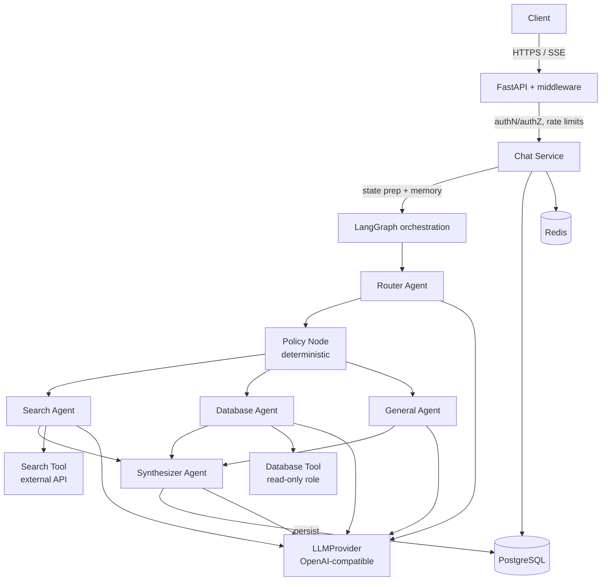

# Architecture

## System Overview

## Request Lifecycle (per turn)

1. **Transport** — `RequestContextMiddleware` assigns `X-Request-ID`, enforces
   the 1 MB body cap, records HTTP metrics/logs.
2. **AuthN** — `get_current_user` resolves Bearer JWT or `X-API-Key` →
   `Principal(user_id, role)`. Anonymous access is impossible.
3. **Rate limiting** — Redis sliding window, per-user then per-IP; atomic Lua
   INCR+EXPIRE; policy on Redis failure is `RATE_LIMIT_FAIL_OPEN` (documented,
   default fail-closed).
4. **Conversation resolution** — create or load with ownership check (403 on
   foreign conversations).
5. **Memory assembly** — short-term window (`MEMORY_SHORT_TERM_WINDOW`
   messages) + semantic recall (embedding cosine top-k above
   `MEMORY_SEMANTIC_MIN_SCORE`).
6. **Graph execution** — see below; checkpoints written to PostgreSQL per
   super-step (thread = conversation id).
7. **Persistence** — under the Redis conversation lock, `append_turn` writes
   user+assistant messages and bumps `version` (optimistic concurrency);
   `agent_runs` rows record every node execution (agent, status, latency,
   prompt version, error).
8. **Memory writes** — deterministic "remember …" extraction always runs;
   LLM-based extraction is config-gated (`MEMORY_EXTRACTION_ENABLED`).
9. **Response** — JSON or SSE (`router_started`, `router_completed`,
   `agent_started`, `agent_completed`, `token`, `error`, `done`).

## Orchestration Graph

`START → router → policy → specialist → synthesizer → END`

- **router** — LLM structured output (`RouterOutput {intent, confidence}`);
  validation failure/timeout degrades to `intent=general, confidence=0` —
  the policy layer then falls back deterministically.
- **policy** — pure application code: `confidence ≥ ROUTER_CONFIDENCE_THRESHOLD`
  → specialist (search/database); otherwise general. Database requests from
  unauthorized roles re-route to general with `fallback_reason=tool_authorization`.
- **specialist** — resolves `selected_agent` from the `AgentRegistry`
  (extensible: new intents register without touching the graph). On failure:
  one fallback execution with the fallback agent.
- **synthesizer** — grounded final answer from the structured specialist
  payload; supports token streaming via `token_sink` in the graph config.

## Key Design Decisions

| Decision | Rationale |
|---|---|
| LLM proposes query *plans*, app compiles SQL | The model can never emit SQL; whitelists + bound parameters + read-only role make injection structurally impossible |
| Deterministic policy outside the LLM | Routing must be testable, auditable, and configurable without prompts |
| Custom async Postgres checkpointer on SQLAlchemy | One connection system for the app; full control of pooling (dedicated pool avoids starvation) |
| Redis lock + Postgres versioning | Lock avoids wasted work; version check is the durable guarantee if Redis fails |
| Structured-output validation with one repair turn | Invalid model output becomes a typed error, never a free-form parse |
| Semantic memory = JSONB + in-process cosine | No pgvector dependency at current scale; interface isolates the swap |
| Fail-open cache, fail-closed rate limit + locks | Availability where safe, correctness where required |

## Memory Model

| Layer | Storage | Lifetime | Content |
|---|---|---|---|
| Short-term | loaded per turn from `messages` | window of N messages | recent turns |
| Persistent | `conversations` + `messages` | forever (until delete) | full history |
| Semantic | `memories` (+ embeddings) | forever | durable user facts/preferences |

Long-term write rules: explicit "remember / don't forget / for future
reference" phrasing is always stored (deterministic regex); LLM extraction
(structured `MemoryCandidate` list) is optional and validated; routine chatter
is never stored.

## Observability Topology

- Each API instance exposes `/metrics`; Prometheus scrapes the service set.
- Logs are JSON on stdout, correlated by `request_id` → `conversation_id`.
- Tracing: OTel spans per LLM call, agent, and tool; OTLP HTTP export to any
  collector; disabled by default (`OTEL_TRACES_ENABLED=false`).

## Repository Layout

See `LLD.md` for module-by-module responsibilities and `HLD.md` for the
component/deployment views.
